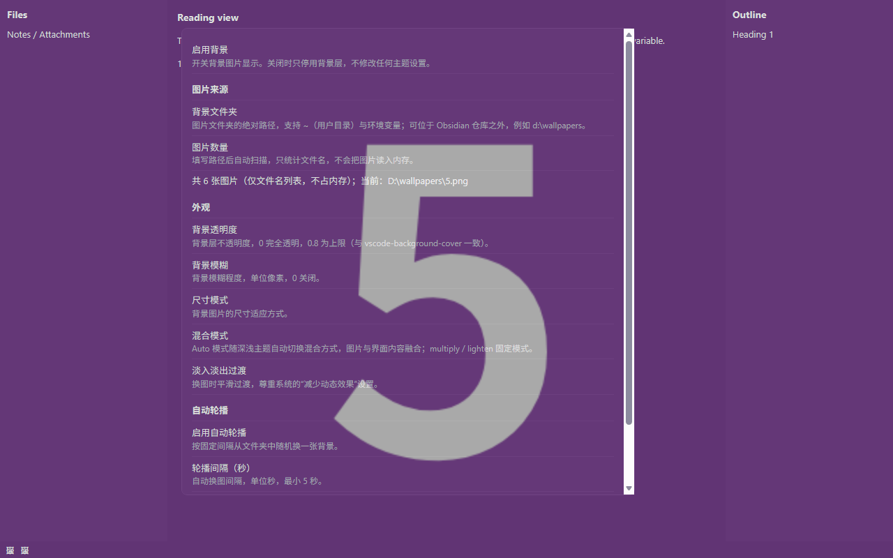
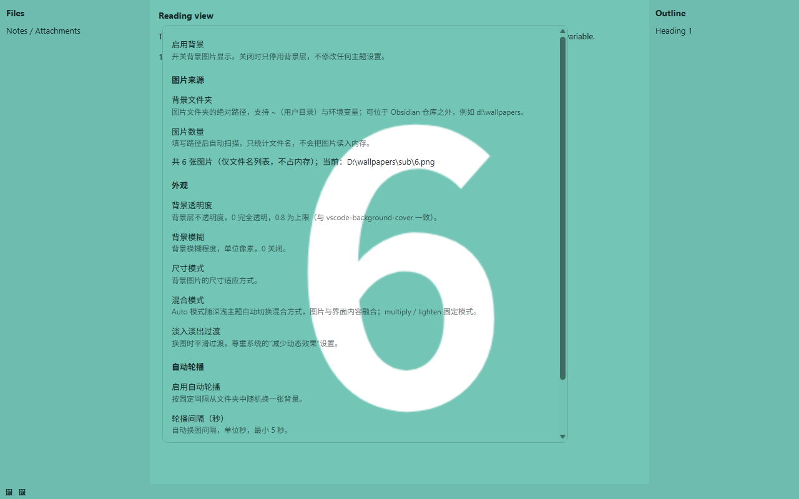

# Background Cover

一个为 [Obsidian](https://obsidian.md) 提供自定义背景的社区插件：把你自己的图片铺在界面之下。

背景的参数体系（透明度 / 模糊 / 尺寸模式 / 混合模式 / 过渡）与文件夹随机轮播参考 [vscode-background-cover](https://github.com/AShujiao/vscode-background-cover)，剔除其粒子效果、顶部宠物、在线图库等装饰功能；Obsidian 端的独立背景层实现思路借鉴 [obsidian-dynamic-theme-background](https://github.com/sean2077/obsidian-dynamic-theme-background)。

> **核心特性**：背景文件夹可以有几千张图（5000+、几十 GB）。插件**只把当前显示的那一张读进内存**，文件夹本身仅扫描文件名列表，因此图库多大都不影响性能。





*插件跟随 Obsidian 自身的语言设置：中文环境显示中文界面，其余语言一律英文。上图取自中文环境。*

[English](README.md) · **中文**

## 功能特性

**本地文件夹背景源**

- 支持 Obsidian 仓库**之外**的文件夹（例如 `d:\wallpapers`）
- 支持 `~`（用户主目录）与 `${ENV}` / `$ENV` 环境变量
- 递归扫描子文件夹，自动识别 png / jpg / jpeg / gif / bmp / webp / svg / jfif / avif

**内存友好**

- 文件夹扫描只产生一个纯字符串数组（文件名列表），从不批量读入图片内容
- 只读取当前这一张，转成 blob URL 交给 CSS
- 5000 张背景图无压力

**不重复随机轮播**

- 全部图片用 Fisher-Yates 洗牌成一条播放序列，一轮内每张只出现一次，用尽才重新洗牌——「随机」不会反复撞到同一张

**VS Code 风格外观设置**

- 背景透明度（0 – 0.8）
- 背景模糊（0 – 100 px）
- 尺寸模式：cover / contain（拉伸）/ center（缩放完整显示）/ repeat（平铺）/ 多种原始尺寸定位
- 混合模式：auto（浅色 multiply、深色 lighten，主题切换即时生效）/ multiply / lighten
- 淡入淡出过渡，尊重系统「减少动态效果」设置

**自动轮播**

- 固定间隔自动换图；也可随时手动换一张

**与主题零冲突**

- 插件只添加独立的背景层（类名统一 `bgc-` 前缀），**不修改任何主题 CSS 变量**（`--background-*`、`--text-*` 等），也不覆盖主题样式

## 安装

### 社区插件市场

插件通过审核上架后，在 **设置 → 第三方插件 → 社区插件市场** 搜索 **Background Cover** 即可安装。

### BRAT（抢先体验）

1. 安装 [BRAT](https://github.com/TfTHacker/obsidian42-brat)
2. 在 BRAT 设置中添加本仓库地址

### 手动安装

1. 从 [最新 Release](../../releases/latest) 下载 `main.js`、`manifest.json`、`styles.css`
2. 放入仓库内名为 `background-cover` 的插件目录：

   ```
   <Vault>/.obsidian/plugins/background-cover/
     ├── main.js
     ├── manifest.json
     └── styles.css
   ```

3. 重启 Obsidian，在 **设置 → 第三方插件** 中启用 **Background Cover**

> 目录名必须与 `manifest.json` 中的 `id`（`background-cover`）一致。
>
> **仅支持桌面端。** 插件通过 Node 的 `fs` 读取图片文件，因此 `isDesktopOnly` 为 `true`，移动端不可用。

## 使用

### 设置

打开 **设置 → Background Cover**。

| 设置项 | 说明 |
| --- | --- |
| 启用背景 | 总开关。关闭时只停用背景层，不修改任何主题设置 |
| 背景文件夹 | 图片文件夹的绝对路径，支持 `~` 与环境变量，可位于仓库之外；填写后自动扫描 |
| 图片数量 | 显示扫描到的图片数。**重新扫描**会重读文件夹并重洗播放序列；**复制文件名**把此刻屏幕上那张图的文件名（只复制文件名，不含路径）放进剪贴板 |
| 背景透明度 | 背景层不透明度 0 – 0.8，默认 0.2 |
| 背景模糊 | 模糊像素 0 – 100，默认 0 |
| 尺寸模式 | `cover`（铺满，保持比例）/ `contain`（拉伸铺满，比例会变形）/ `center`（缩放至完整显示，居中）/ `repeat`（平铺）/ 各种原始尺寸定位 |
| 混合模式 | `auto`（随主题）/ `multiply` / `lighten`。仅在壁纸位于界面之上（未开「让主题背景透明」）时生效；壁纸成为背景层后没有可混合的对象 |
| 淡入淡出过渡 | 换图平滑过渡，默认开启 |
| 让主题背景透明 | 把主题的不透明背景色改为透明，**并让壁纸沉到界面之下**，使界面与图片不再互相混色。**唯一会覆盖主题背景颜色的功能**，默认关闭，详见下方专节 |
| 标题栏分隔线 | 标题栏与下方工作区之间的 1px 细线（需先开启上一项），默认开启 |
| 侧边栏分隔线 | 左右侧边栏与中间工作区之间的细线（需先开启上一项），默认开启 |
| 分隔线颜色 | 上面两条细线的颜色，默认中性灰 `#808080` |
| 分隔线浓度 | 细线的不透明度 0 – 1，默认 0.45 |
| 启动时随机更换 | 开启后每次启动都随机换一张；关闭（默认）则恢复上次退出时的那张 |
| 启用自动轮播 | 固定间隔随机换图，默认关闭 |
| 轮播间隔（秒） | 自动换图间隔，最小 5 秒 |
| 随机换一张 | 立即从文件夹取下一张 |

### 命令

- **更换背景**：按播放序列取下一张
- **启用或停用背景**：开关背景层
- **复制诊断信息**：把运行环境（Electron / Chromium 版本、`color-mix` 与 `backdrop-filter` 支持情况）、主题变量、浮层 DOM 结构与相关计算样式复制到剪贴板。排查「分隔线不生效」「某个区域看起来还是不一样」这类只在特定环境出现的问题时，先跑一次它

诊断报告**固定为英文**，方便原样贴进 issue。

### 状态栏

底部状态栏有一个 🖼 按钮，点击即可换一张。

### 换图顺序（播放序列）

「随机」不是每次独立抽一张，而是一条**洗牌后的播放序列**：

- 插件把当前文件夹的全部图片洗牌成一条序列，命令、状态栏按钮、自动轮播**都按这条序列逐张取下一张**，因此**同一轮内每张只出现一次**；5000 张图就是连点 5000 次才会见到底二轮
- 一轮走完、背景文件夹路径被修改、或点击**重新扫描**时，都会重新洗牌
- **重新扫描**只重洗序列与刷新图片数量，屏幕上已显示的图不会变；下一次换图才开始走新序列
- 重启 Obsidian 会恢复上次显示的那张图并重新洗牌；若新序列的下一张恰好就是当前这张，会自动跳到再下一张
- 开启**启动时随机更换**后，启动时不再恢复上次那张，而是直接从新序列取一张

> 只有图库里**确实只有 2–3 张图**时，「一轮内不重复」才会让你感觉像在几张之间循环——那是可选图片数量本身的限制。

## 权限与隐私

这一节说明插件到底访问了什么、为什么需要，属于必须的披露。

- **完全不联网**：没有任何 HTTP 请求，不下载任何东西，没有在线图库
- **无遥测、无统计、无账号**：关于你和你的仓库的任何信息都不会离开你的机器
- **会读取你指定的图片文件夹，该文件夹可以在仓库之外**。这正是插件的用途：壁纸图库通常放在 `d:\wallpapers` 这样的位置，而不是仓库里。插件只读取该文件夹的文件名列表，并在显示某张图时读取那一个文件。它**不写入**该文件夹、不删除任何文件，也不会去扫描你没有配置的目录
- 如果你希望所有东西都在一个地方，也可以把它指向**仓库内部**的文件夹
- **内存中只有文件名列表和当前显示的这一张图**；被替换掉的图片会立即 `revokeObjectURL`
- 唯一的「写入」是插件自身的设置项，保存在仓库内的插件 `data.json` 里，与其他插件一样
- **不执行远程代码**：运行时不拉取、不 eval 任何脚本，更新只通过正常的插件发行版进行

## 与主题的兼容性

插件默认**只修改背景**，不触碰任何主题变量——唯一的例外是可选且默认关闭的**让主题背景透明**。插件始终不会改你的应用外观或主题设置。

背景层有两种存在方式，区别很关键：

- **叠加模式（默认，未开主题透明）**：一个独立的 `position: fixed` 全屏层，用 `mix-blend-mode` 叠加在工作区内容之上（与 vscode-background-cover 的默认效果一致），`z-index` 取 **20**——高于工作区与窗口背景条（Obsidian 的 `--layer-cover 5` / `--layer-sidedock 10` / `--layer-status-bar 15`），低于浮动面板（`--layer-modal 50` / `--layer-notice 60` / `--layer-menu 65` / `--layer-tooltip 70`），所以菜单、命令面板、提示、悬浮预览都不会被壁纸叠加。正因为是叠加层，主题自带的不透明背景色不会遮住图片，也就不需要改写 `--background-primary` 之类的变量——这是本插件与「改写主题变量」类背景插件的根本区别。代价是混合模式会把它下面的**一切**都合成进来，包括界面内容本身（见下）
- **真背景模式（开启「让主题背景透明」）**：壁纸层降到 **`z-index: -1`**，混合模式强制为 `normal`，只与工作区底色（深色主题纯黑、浅色主题纯白）合成；正文、面板、控件则整层不透明地画在它之上，各自保持配色，不会被拉进画面。能这么摆的依据在 Obsidian 自己的样式表里：`body` 带 `contain: strict`，因此是层叠上下文，`z-index: -1` 的子元素正好落在底色之上、整个界面之下。这个模式要求主题的不透明表面已经透明，而那正是上一项开关做的事——两者必须一起用

> 两种模式下 Obsidian 的浮层都不受影响：菜单、提示、命令面板、弹窗都保留自己不透明的底色，不会被壁纸染色。想让壁纸盖到这些面板之上（不推荐，它们会被混合模式染色），把 `styles.css` 中 `.bgc-layer` 的 `z-index` 调大即可。

> **无边框窗口模式**（Windows/Linux 常见的 `is-hidden-frameless`）由 Obsidian 自己处理：核心就给 `.titlebar` 写了 `background: transparent`、`border: none` 与 `z-index: var(--layer-popover)`。它是一条透明的拖拽区，两种模式下壁纸都能透出来，插件因此不再需要动它的 `z-index`（1.0.1 曾把它压到 `--layer-status-bar` 15，那个补丁在壁纸沉到界面之下后已无必要）。

> 需要 Obsidian **1.13.0** 或更高版本（动态样式使用官方的 `setCssProps` API）。

## 让主题背景透明（插件内开关）

有些主题会给工作区、侧边栏、标题栏铺**不透明**的背景色（例如 Royal Velvet 用 `--layer-0~4` 一套色板铺满界面）。在叠加模式下，这些颜色会作为混合背景参与 `mix-blend-mode` 运算，把壁纸往主题配色上拉——表现为壁纸发灰、发紫、暗部被提亮。

> 实测结论：这通常不是主题真的加了滤镜或遮罩层（Royal Velvet 里查不到 `filter` / `backdrop-filter` / 全屏覆盖层），而是混合模式与「它下面的东西」共同作用的正常结果。

打开 **设置 → Background Cover → 与主题配合 → 让主题背景透明**，它一次做两件事，缺一不可：

1. 把这些不透明表面改成透明，它们就不再给壁纸染色；
2. 让壁纸**沉到界面之下**（`z-index: -1`，混合模式 `normal`）。这一步解决的是另一半问题：叠加模式下壁纸还会与界面内容合成，深色主题里正文、表单、代码块这些**亮部**会经由 `lighten` 被抬进画面，图像与界面看起来各自半透明；浅色主题里则是浅色面板被乘进图像，像给图片蒙了一层东西。成为真正的背景层后，壁纸只与中性底色合成，界面整层叠在它上面。

- **这是本插件唯一会覆盖主题背景颜色的功能，默认关闭**；关闭时插件依旧完全不碰主题变量
- **只作用于工作区**：菜单、提示、悬浮预览完全不受影响。变量覆盖写在 `.workspace` 作用域内（自定义属性向下继承），而 Obsidian 的弹窗是 `body` 下与 `.app-container` 平级、位于 `.workspace` 之外，因此不会被波及。**不要把这些变量写回 `body` / `.theme-*`** —— 一旦 `--background-primary` 在全局变成透明，设置窗口、命令面板、菜单都会跟着变透明
- **笔记标题那一行**（`.view-header`）也一并处理：核心用 `--file-header-background` / `--file-header-background-focused` 给它铺底，这两个变量同样在根节点定型、取 `--background-primary`；而且它的「活动叶 + 窗口聚焦」规则是 4 个类（`(0,4,0)`），会压过普通的元素级覆盖，所以插件直接在变量层置空。**判断这类问题的小技巧**：如果某个区域只在「焦点在正文」时和别人不一样、一点侧边栏或一打开独立设置窗口就恢复正常，那就是这种「焦点/活动状态相关、且优先级更高」的规则在起作用
- **补回分隔细线**：主题常把 Obsidian 的分隔线来源 `--background-modifier-border`（`--divider-color` 默认取它）设成 transparent，于是界面完全没有分隔线。开启后会在**顶部（标签栏 / 标题栏）与工作区之间**补一条 1px 细线，并给侧边栏的 `.workspace-leaf-resize-handle` 上色，**左右侧边栏与中间工作区之间**也恢复成一条细线。两条线可分别开关，颜色与浓度都在设置里调；只给这个手柄上色，不动工作区里其它任何分隔线
- 开启后工作区底色会变成纯黑（深色主题）/ 纯白（浅色主题）。壁纸正是与这个底色做合成，所以它必须是「混合中性色」——底色带偏色会把整张图染上一层。这个底色只会透过壁纸本身显出来（它在壁纸之下，工作区各表面又都是透明的），不会把浅色主题变暗或反过来
- **本来没有底色的正文元素，不会平白多出一块底色。** 表格、公式块、引用块、代码（行内与围栏块）本身都是透明的排版元素，但主题常给它们铺一层——Royal Velvet 就用 `--layer-1` / `--layer-2` 给表格行做交替底色，用 `--layer-1` 铺公式块与引用块。壁纸作为叠加层时这些颜色被压在最下面、看不见；壁纸沉到界面之下后，它们就成了一道道压在壁纸上的不透明色块（浅色主题下几乎就是白色）。这一项会清掉它们的 **background-color**，去掉表格的**外框**（主题常用 `outline` 画一圈），并把**表格悬浮行**换成一层淡蒙层（深色主题浅色蒙层、浅色主题轻微加深）而不是主题那种不透明色块。主题有意为之的装饰都保留：表头渐变、公式块与引用块两侧的色条；清单之外的元素一律不碰（面板、按钮、callout、标签、侧边栏高亮）。
- **透明度仍然只是透明度**：取 0.4 时图片占 40%、工作区底色占 60%，所以深色主题下偏暗、浅色主题下发白——这是「半透明图层盖在浅色背景上」的定义，插件没法消掉。1.1.0 改变的是「界面不再混进画面」：同样是低透明度，图像现在是整体均匀偏淡，而不在有文字和面板的地方被搅浑。浅色主题完全受支持；想让壁纸保留更多颜色，把透明度调高即可。
- 另外处理了 Bases 视图的不透明覆盖层，以及**状态栏与标题栏**这两条窗口背景栏（它们在 `.workspace` 之外，需要单独处理，否则壁纸在这两条上会被切断）。不想让它们跟着透明，删掉 `styles.css` 里对应的两条规则即可

## 工作原理

- **背景层结构**：一个全屏根容器 `.bgc-layer`（承载 `mix-blend-mode` 与模糊，换图期间**属性完全恒定**）+ 两个图片子层 `.bgc-layer-image`，两层交替做 `opacity` 交叉淡化。容器挂在 `document.body` 上，位置在 `.app-container` 之后；它的 `z-index` 与混合模式完全由 CSS 依据 `body` 上有没有 `bgc-transparent-theme` 决定（叠加模式 `z-index: 20` / 真背景模式 `z-index: -1`），因此切换主题透明开关时 JS 从不碰这一层
- **复制文件名**：设置页的按钮读的是背景层自己记录的「当前实际显示的那张图」（`getCurrentPath()`），不是持久化的字段，所以自动轮播期间点它拿到的就是此刻屏幕上的图；只复制**文件名**，因为文件名足够在图库文件夹里找到同一张图，而完整路径会把本机目录结构带进你粘贴的地方（诊断报告里要用户删掉 `background.imageFolder` 一行也是同一个原因）
- **为什么混合模式要放在不参与动画的父层上**：`mix-blend-mode` / `filter` 所在元素在 `opacity` 动画期间会被合成器提升为独立合成层，混合模式随之退化为 `normal`（表现为切图瞬间整屏变亮、盖住界面）。vscode-background-cover 的 A6 修复记录了这个坑，本插件据此把「混合模式 + 模糊」与「淡入淡出」拆到不同元素上
- **换图不做任何延时清理**：非活动子层 `opacity` 为 0 本就不可见，它的 `background-image` 保留到下次被覆盖为止。早期版本用 400ms 定时器清理「旧层」，快速连点时会把刚刚成为活动层的图一起清掉，导致背景整体消失（已修复，且不再使用任何定时器）
- **本地图片走 blob URL，而不是 base64 data URL**（这一点很关键）：图片文件被读取后转成 `blob:` URL（约 50 个字符）写入图片层的 `--bgc-image` 变量。**不要改用 `data:...;base64,...`**：那需要把整张图塞进行内 CSS，而浏览器对单个 CSS 声明值有长度上限，超限的值会被**静默丢弃**（无任何报错），`background-image: var(--bgc-image, none)` 随即解析为 `none`，背景整体消失。实测（Chromium）：2 MB 的值能完整保存，4 MB 的值 `getPropertyValue()` 返回空串。高清壁纸的 base64 常有数 MB 到数十 MB，因此 data URL 方案会表现为「大部分图点了没反应，偶尔小图能用」。blob URL 既没有长度上限，也省掉 base64 的 33% 膨胀
- **同一时刻内存中只有当前这一张图片**：被替换掉的 blob URL 会立刻 `revokeObjectURL`，背景层卸载时也会全部释放
- **变量取值一律合法**：`--bgc-*` 只会被写入合法 CSS 记号（`none` / `cover` / `blur(4px)` …），且不使用嵌套 `var()`。因为 `var()` 的兜底值只在变量**未定义**时生效，一旦变量被定义成非法记号，整条声明（包括 `mix-blend-mode`）都会被丢弃——这正是「背景在、混合模式却失效」的常见根因。混合模式与过渡因此完全用 CSS 类表达，不用变量
- **混合模式 auto 是纯 CSS**：依据 `body.theme-light` / `body.theme-dark` 选择 multiply / lighten，主题切换即时生效，不需要 JS 监听主题变化
- **随机机制**为「洗牌播放列表」（Fisher-Yates）：全部图片洗牌成一轮播放顺序，一轮内每张只出现一次，用尽才重新洗牌，手动切换与自动轮播共用同一个播放列表
- **设置页的名称与实际显示的图严格一致**：背景层自己记录「当前实际显示的那张图」（`getCurrentPath()`），设置页读取的是这个真实状态；同时每次切换带请求序号，只有最后一次发起的读取会被应用，异步读图的先后顺序不会造成错位

> **超大图提示**：图库里若有个别几十 MB 的超高分辨率图（例如全景图，可轻松超过 8000×5000），切到它时解码会明显变慢、瞬时内存较高——这是图片本身的代价，插件同一时刻只保留当前这一张。**随机换一张**可以跳过它。

## 开发

```bash
npm install      # 安装依赖
npm run dev      # 监听模式编译到 output/
npm run build    # 生产构建（tsc 类型检查 + esbuild 打包）到 output/
npm run lint     # ESLint 检查
```

构建产物统一输出到 `output/`，包含 `main.js`、`manifest.json`、`styles.css`，可直接安装或作为 GitHub Release 资产。

源码结构：

```
src/
  main.ts         # 插件生命周期、命令、状态栏、文件夹扫描缓存
  background.ts   # 背景层：双图片层、blob URL、混合模式类
  settings.ts     # 设置接口、默认值与设置页
  i18n.ts         # 界面文案（中英）与语言选择
  css.ts          # 尺寸模式 → CSS 映射、颜色工具
  folder.ts       # 路径展开、递归扫描、洗牌播放列表
  diagnostics.ts  # 「复制诊断信息」报告
```

改动前请先看 [CONTRIBUTING.md](CONTRIBUTING.md)：里面有不可放宽的约束、界面文案规则与发布流程。

**本仓库没有自动化测试套件。** 改动通过无头浏览器加载真实构建产物、在本地重建 Obsidian DOM 的工装上验证；该工装依赖本机的壁纸文件夹，不随仓库提供。因此如果你改动了渲染行为（混合模式、z-index、主题透明化），请在 PR 里说明你是怎么验证的、用的是哪个主题。

## 发布

1. 用 `npm version <x.y.z>` 升版本。`version` 脚本会同步 `manifest.json` 与 `versions.json`；`.npmrc` 设了 `tag-version-prefix=""`，所以 git 标签是不带 `v` 前缀的裸版本号
2. 往 [CHANGELOG.md](CHANGELOG.md) 补一条对应版本的记录
3. 推送标签。`.github/workflows/release.yml` 会构建插件、生成构建来源证明（provenance attestation），并发布挂有 `main.js`、`manifest.json`、`styles.css` 的 release。标签与 `manifest.json` 的 `version` 不一致时工作流会直接失败
4. Obsidian 按「tag == manifest 的 version」查找 release，所以标签必须完全一致，且 release 必须是**已发布**状态而不是草稿

## 提交到官方社区目录

提交入口已改为 [community.obsidian.md](https://community.obsidian.md) 自助流程，**不再需要向 `obsidian-releases` 提 PR**。

1. 先创建 GitHub Release：tag 与 `manifest.json` 的 `version` 完全一致，附件包含 `main.js`、`manifest.json`、`styles.css`
2. 用 Obsidian 账号登录 [community.obsidian.md](https://community.obsidian.md)，连接你的 GitHub 账号
3. 按仓库地址添加插件，阅读并同意 [Developer policies](https://docs.obsidian.md/community-directory/developer-policies) 后提交
4. 目录会读取默认分支 HEAD 上的 `manifest.json`，务必先提交。`id` 必须在所有已发布插件中唯一，且**不能包含 `obsidian`**
5. 按自动审核给出的提示修正后，升级版本并发布新的 release

权威说明见 [Submit your plugin](https://docs.obsidian.md/plugins/releasing/submit-plugin) 与[插件提交要求](https://docs.obsidian.md/community-directory/submission-requirements-for-plugins)。

## 致谢与引用

本项目的功能设计与实现参考了以下开源项目：

- **[vscode-background-cover](https://github.com/AShujiao/vscode-background-cover)**（MIT，© 2021 ashujiao）：背景参数体系（透明度 / 模糊 / 尺寸模式 / 混合模式 / 过渡动画）、文件夹随机轮播与「只加载当前图片」的内存策略；以及其 `src/loaderFragments.ts` 中关于「`mix-blend-mode` / `filter` 在 opacity 动画期间被合成器提升后混合退化」的 A6 修复记录——本插件的背景层结构正是据此把混合模式与模糊移出动画层
- **[obsidian-dynamic-theme-background](https://github.com/sean2077/obsidian-dynamic-theme-background)**（MIT，© 2025 Sean2077）：Obsidian 端背景层的实现思路（背景作为独立层叠加、浅色 multiply / 深色 lighten 的混合语义、blur 过滤器的用法）
- **[obsidian-sample-plugin](https://github.com/obsidianmd/obsidian-sample-plugin)**（ISC，© 2020-2026 Dynalist Inc.）：本项目所衍生的脚手架（TypeScript + esbuild 构建配置、GitHub Actions 工作流、manifest 规范）
- **[esbuild](https://esbuild.github.io/)**：打包工具

两个背景类参考项目均为 MIT 许可，因此这里借鉴的设计思路与参数语义都在其许可范围内。本项目是**独立实现**：未复制任何上游代码文本；上面列出出处是应当做的事，而不是许可强制要求的结果。

脚手架是另一回事：它**确实**衍生自 obsidian-sample-plugin，因此按 ISC 的要求保留了其版权与许可声明，见 [THIRD-PARTY-NOTICES.md](THIRD-PARTY-NOTICES.md)。

## AI 辅助声明

本项目的代码与文档由 AI 辅助完成，具体模型如下：

- **字节跳动豆包（Doubao）大语言模型**：初版需求分析、架构设计、代码编写、文档与构建配置
- **DeepSeek（`deepseek-flash`，经由 DeepSeek Harness 编码智能体）**：修复「快速连点后背景整体失效」与「设置页显示的名称与实际背景不符」两个缺陷；**定位并修复了更深的根因——把图片写进行内 CSS 的 data URL 超过浏览器对单个 CSS 声明值的长度上限后被静默丢弃（实测阈值在 2–4 MB 之间），改为 blob URL**；重构背景层结构（把混合模式/模糊与淡入淡出拆分到不同元素）；补齐混合模式与透明度的失效逻辑；改写样式、构建产物与本文档；用无头浏览器加载真实构建产物、在本地 Obsidian DOM 工装上验证每一项改动；并完成界面中英双语化、补齐贡献指南与 issue 模板、准备社区目录提交

所有 AI 生成内容均已由人工复核，并通过 TypeScript 类型检查、ESLint 与构建产物渲染验证。若你对 AI 辅助开发有疑虑，可查看源码与提交历史中的说明。

## 许可证

本项目以 [MIT License](LICENSE) 开源。

---

**Disclaimer**: This project is an independent community plugin and is not affiliated with or endorsed by Obsidian.
